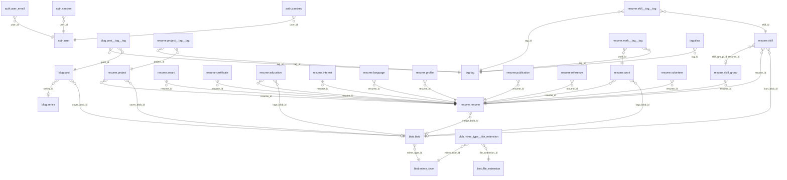

# josholson

## auth

| Table                                      | Columns |
| ------------------------------------------ | ------: |
| [`auth.passkey`][table:auth.passkey]       |      11 |
| [`auth.session`][table:auth.session]       |       8 |
| [`auth.user`][table:auth.user]             |       5 |
| [`auth.user_email`][table:auth.user_email] |       6 |

## blob

| Table                                                                    | Columns |
| ------------------------------------------------------------------------ | ------: |
| [`blob.blob`][table:blob.blob]                                           |       9 |
| [`blob.file_extension`][table:blob.file_extension]                       |       2 |
| [`blob.mime_type`][table:blob.mime_type]                                 |       3 |
| [`blob.mime_type__file_extension`][table:blob.mime_type__file_extension] |       3 |

## blog

| Table                                              | Columns |
| -------------------------------------------------- | ------: |
| [`blog.post`][table:blog.post]                     |      13 |
| [`blog.post__tag__tag`][table:blog.post__tag__tag] |       2 |
| [`blog.series`][table:blog.series]                 |       5 |

## form

| Table                                | Columns |
| ------------------------------------ | ------: |
| [`form.contact`][table:form.contact] |      11 |

## resume

| Table                                                        | Columns |
| ------------------------------------------------------------ | ------: |
| [`resume.award`][table:resume.award]                         |       8 |
| [`resume.certificate`][table:resume.certificate]             |      10 |
| [`resume.education`][table:resume.education]                 |      14 |
| [`resume.interest`][table:resume.interest]                   |       6 |
| [`resume.language`][table:resume.language]                   |       8 |
| [`resume.profile`][table:resume.profile]                     |       7 |
| [`resume.project`][table:resume.project]                     |      20 |
| [`resume.project__tag__tag`][table:resume.project__tag__tag] |       2 |
| [`resume.publication`][table:resume.publication]             |      11 |
| [`resume.reference`][table:resume.reference]                 |      14 |
| [`resume.resume`][table:resume.resume]                       |      19 |
| [`resume.skill`][table:resume.skill]                         |      14 |
| [`resume.skill__tag__tag`][table:resume.skill__tag__tag]     |       2 |
| [`resume.skill_group`][table:resume.skill_group]             |       5 |
| [`resume.volunteer`][table:resume.volunteer]                 |      11 |
| [`resume.work`][table:resume.work]                           |      15 |
| [`resume.work__tag__tag`][table:resume.work__tag__tag]       |       2 |

## tag

| Table                          | Columns |
| ------------------------------ | ------: |
| [`tag.alias`][table:tag.alias] |       3 |
| [`tag.tag`][table:tag.tag]     |       5 |

## Domains

| Domain                                                                | Base type           |
| --------------------------------------------------------------------- | ------------------- |
| [`color.hex`][domain:color.hex]                                       | [`TEXT`][pg:text]   |
| [`hash.sha256`][domain:hash.sha256]                                   | [`BYTEA`][pg:bytea] |
| [`jsonb.object`][domain:jsonb.object]                                 | [`JSONB`][pg:jsonb] |
| [`temporal.year_optional_month`][domain:temporal.year_optional_month] | [`TEXT`][pg:text]   |
| [`text.email`][domain:text.email]                                     | [`TEXT`][pg:text]   |
| [`text.kebab_case`][domain:text.kebab_case]                           | [`TEXT`][pg:text]   |
| [`text.trimmed`][domain:text.trimmed]                                 | [`TEXT`][pg:text]   |
| [`text.url`][domain:text.url]                                         | [`TEXT`][pg:text]   |

## Relations

---

> Generated by [scripts/schema-docs.cs](../../scripts/schema-docs.cs). Do not edit by hand.

[domain:color.hex]: domains.md#colorhex
[domain:hash.sha256]: domains.md#hashsha256
[domain:jsonb.object]: domains.md#jsonbobject
[domain:temporal.year_optional_month]: domains.md#temporalyear_optional_month
[domain:text.email]: domains.md#textemail
[domain:text.kebab_case]: domains.md#textkebab_case
[domain:text.trimmed]: domains.md#texttrimmed
[domain:text.url]: domains.md#texturl
[pg:bytea]: https://www.postgresql.org/docs/19/datatype-binary.html
[pg:jsonb]: https://www.postgresql.org/docs/19/datatype-json.html
[pg:text]: https://www.postgresql.org/docs/19/datatype-character.html
[table:auth.passkey]: auth.passkey.md
[table:auth.session]: auth.session.md
[table:auth.user]: auth.user.md
[table:auth.user_email]: auth.user_email.md
[table:blob.blob]: blob.blob.md
[table:blob.file_extension]: blob.file_extension.md
[table:blob.mime_type]: blob.mime_type.md
[table:blob.mime_type__file_extension]: blob.mime_type__file_extension.md
[table:blog.post]: blog.post.md
[table:blog.post__tag__tag]: blog.post__tag__tag.md
[table:blog.series]: blog.series.md
[table:form.contact]: form.contact.md
[table:resume.award]: resume.award.md
[table:resume.certificate]: resume.certificate.md
[table:resume.education]: resume.education.md
[table:resume.interest]: resume.interest.md
[table:resume.language]: resume.language.md
[table:resume.profile]: resume.profile.md
[table:resume.project]: resume.project.md
[table:resume.project__tag__tag]: resume.project__tag__tag.md
[table:resume.publication]: resume.publication.md
[table:resume.reference]: resume.reference.md
[table:resume.resume]: resume.resume.md
[table:resume.skill]: resume.skill.md
[table:resume.skill__tag__tag]: resume.skill__tag__tag.md
[table:resume.skill_group]: resume.skill_group.md
[table:resume.volunteer]: resume.volunteer.md
[table:resume.work]: resume.work.md
[table:resume.work__tag__tag]: resume.work__tag__tag.md
[table:tag.alias]: tag.alias.md
[table:tag.tag]: tag.tag.md
