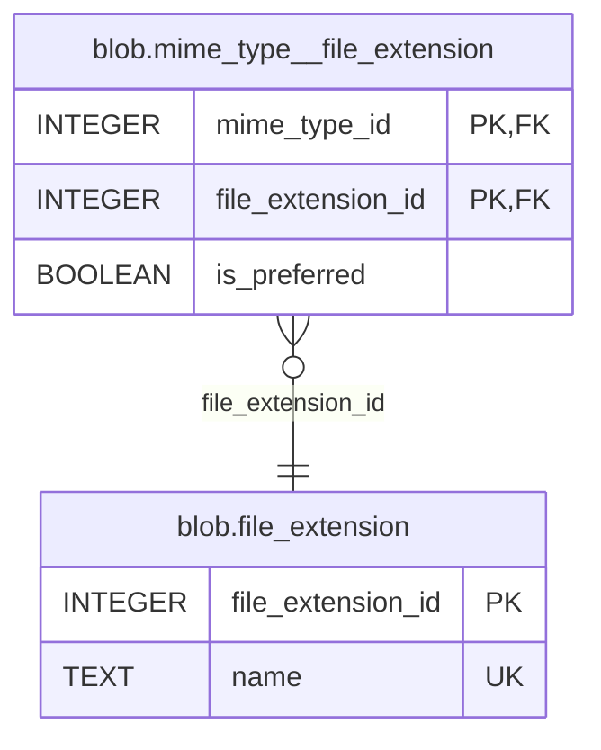

# `blob.file_extension`

## Columns

| Name                | Type                    |   Nullable | Default                        |
| ------------------- | ----------------------- | ---------: | ------------------------------ |
| `file_extension_id` | [`INTEGER`][pg:integer] | `NOT NULL` | `GENERATED ALWAYS AS IDENTITY` |
| `name`              | [`TEXT`][pg:text]       | `NOT NULL` |                                |

## Constraints

### Primary key

| Name                | Definition          |
| ------------------- | ------------------- |
| `pk_file_extension` | `file_extension_id` |

### Unique constraints

| Name                     | Definition |
| ------------------------ | ---------- |
| `uq_file_extension_name` | `name`     |

### Check constraints

| Name                            | Definition                   |
| ------------------------------- | ---------------------------- |
| `ck_file_extension_name_format` | `name ~ '^[a-z0-9]+$'::text` |

## Relations

### Incoming foreign keys

| Name                                           | Columns             | Table                                                                    | Ref Columns         | On Delete | On Update   |
| ---------------------------------------------- | ------------------- | ------------------------------------------------------------------------ | ------------------- | --------- | ----------- |
| `fk_mime_type__file_extension__file_extension` | `file_extension_id` | [`blob.mime_type__file_extension`][table:blob.mime_type__file_extension] | `file_extension_id` | `CASCADE` | `NO ACTION` |

### Diagram

---

> Generated by [scripts/schema-docs.cs](../../scripts/schema-docs.cs). Do not edit by hand.

[pg:integer]: https://www.postgresql.org/docs/19/datatype-numeric.html#DATATYPE-INT
[pg:text]: https://www.postgresql.org/docs/19/datatype-character.html
[table:blob.mime_type__file_extension]: blob.mime_type__file_extension.md
